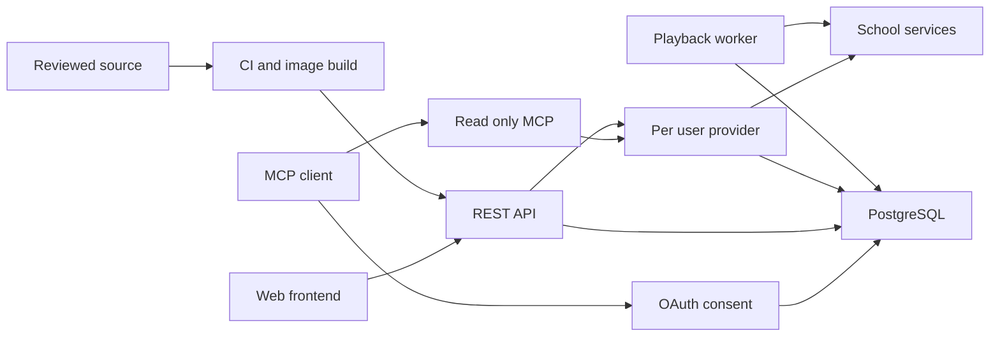

# ALMS Server threat model — 2026-10-24

## Executive summary

ALMS separates web sessions, school sessions and read-only MCP grants. The main residual risks are account admission policy, authentication lifecycle under concurrent use, upstream content/parse boundaries and resource exhaustion. This review found two dependency advisories and an opt-in MCP input budget gap; the accompanying patch addresses these. It does not certify an internet deployment or establish an authentication bypass.

## Scope and assumptions

Scope: REST/OAuth/MCP entry points, provider/storage boundaries, uploads/media workers and CI. Baseline: public commit `b94e56e` plus the accompanying patch. Intended use and context were already supplied by the owner: SSU only, invited users, public HTTPS, operator-owned Docker/PostgreSQL, separate frontends and read-only MCP. Existing submissions are preserved.

No production attack traffic, school record writes or credential extraction was used. Reverse-proxy admission/rate-limit rules, image OS advisories, backup recovery and deployed key rotation were not inspected. The absence of an in-app invite check is a conditional deployment risk until external admission is verified.

## System model

### Primary components

`src/server.ts` starts Fastify and PostgreSQL; `src/app.ts` exposes REST. `src/auth.ts` verifies school SSO. `src/provider.ts` delegates per-user school access. `src/mcp-auth` persists OAuth state and validates session-bound consent; `src/mcp-routes.ts` exposes read-only tools. `compose.yaml` separates API, worker, migration and database roles.

### Data flows and trust boundaries

- Browser → REST: HTTPS, configured client/Origin, secure session cookie or PKCE bearer, CSRF on writes, schema validation. Evidence: `src/frontend-clients.ts`, `src/auth.ts`, `src/app.ts`.
- MCP client → OAuth → MCP resource: authorization code/S256, exact redirect/resource/scope, user consent and owner/session validation. Evidence: `src/mcp-auth/index.ts`, `src/mcp-config.ts`.
- API → school provider: per-user school credentials and opaque resource identifiers; school response validation and feature support status. Evidence: `src/provider.ts`, `src/mcp-tools/validation.ts`.
- API/worker → PostgreSQL: bound query parameters, owner predicates, transactions and separate authorization records. Evidence: `src/store.ts`, `src/mcp-auth/repository.ts`, migrations.
- Contributor → CI → image: locked dependencies, limited GitHub token permissions, exact action SHAs, tests and secret scanning. Evidence: `.github/workflows`, `package-lock.json`, Dockerfiles.

#### Diagram

## Assets and security objectives

| Asset | Why it matters | Objective |
| --- | --- | --- |
| School/web/OAuth credentials | Account and school data access | Confidentiality, integrity |
| Assignments and attendance | Incorrect writes can affect academic records | Integrity |
| User and course data | Must remain with the correct owner | Confidentiality |
| Grants, completion records and jobs | Revocation and ownership must persist | Integrity, availability |
| CPU, memory, upstream quotas | Shared server capacity is finite | Availability |
| Signing keys, images and source | Changes affect all users | Confidentiality, integrity |

## Attacker model

### Capabilities

An internet caller can send malformed requests and arbitrary headers; an authenticated school user can choose identifiers and repeatedly invoke allowed reads. A malicious page can attempt CSRF. Upstream course text can contain hostile instructions. A contributor can propose source/dependency changes.

### Non-capabilities

The model does not assume access to signing keys, the operator's host, another user's cookies, PostgreSQL administration or arbitrary changes to the school SSO verifier. A proposed pull request is not production execution. MCP callers have no submission/playback tool.

## Entry points and attack surfaces

| Surface | Boundary | Controls and evidence |
| --- | --- | --- |
| Auth start/callback | Browser/school → API | Stored attempt, exact client return, verified school subject; `src/auth.ts` |
| Consent/token/revocation | Browser/client → OAuth | Consent POST: Origin, CSRF and nonce. Token/revocation: OAuth client/token checks; code exchange also requires S256. Grants remain session-bound; `src/mcp-auth` |
| MCP POST | Client → provider | Bearer/owner, no cookie fallback, input/output limits; `src/mcp-routes.ts` |
| REST object/file/job routes | User → storage/school | Session, owner predicates and write gates; `src/app.ts`, `src/store.ts` |
| School response/media | Upstream → parser/browser | Schemas, verified targets, media policies; `src/provider.ts`, `src/verified-video-media.ts` |
| Dependencies and CI | Contributor/upstream → build | Lock, audit, exact action SHAs, secret scan; `.github/workflows` |

## Top abuse paths

1. Another school's/resource's token → MCP endpoint → attempt to read data. Exact audience/resource/client and active grant checks reject it.
2. Malicious page → forged consent POST or altered redirect → attempt to steal a code. Origin/CSRF/nonce, exact redirects and S256 are enforced.
3. Logged-in user → another course/owner identifier → cross-user read. Owner derives from validated principal, not arguments; provider and DB checks remain required.
4. Authenticated caller → many/wide requests → shared process exhaustion. Byte/element/time/concurrency/rate limits reduce work; production shared ingress behavior remains unmeasured.
5. Valid but uninvited school account → SSO callback → new application account. There is no app admission gate; external restriction must be verified or an explicit invite policy implemented.
6. Malicious school prose → model reads instructions → another client tool leaks data. Server projection and read-only tools reduce scope; host-side data trust and tool approvals remain necessary.
7. Compromised dependency or moving build tag → image → access to server credentials. Dependency patches/audit and action pinning reduce supply-chain exposure; container image scanning and digest policy remain follow-ups.

## Threat priorities

| ID | Likelihood | Impact | Priority and reason |
| --- | --- | --- | --- |
| T1 token/consent substitution | Low with current controls | High | Medium residual: lifecycle/concurrency tests and live revocation remain important. No bypass demonstrated. |
| T2 cross-user reads | Low with owner binding | High | Medium residual: verify with a second real account; synthetic tests are not that evidence. |
| T3 resource exhaustion | Medium | Medium | Medium: shared capacity; explicit element budget added, existing request limits retained. |
| T4 uninvited admission | Conditional on external gate | Medium | Medium if invite-only deployment has no external enforcement; policy gap, not school identity bypass. |
| T5 upstream prompt injection | Medium | Depends on host tools | Medium conditional: ALMS cannot enforce another AI host's tool policy. |
| T6 supply-chain change | Low to medium | High | Medium residual: known package advisories patched; base images and provenance need further work. |

## Mitigations and recommendations

Keep current owner/session/resource checks and no automatic school writes. Add admission before account/session creation when operating invite-only. Introduce operator-controlled MCP clients before considering CIMD; define metadata fetch/SSRF limits before remote registration. Bind future pagination to owner/filter/snapshot. Re-test refresh replay, logout and account switching with independent sessions. Observe bounded error classes and latency without logging tokens or raw school content. Scan built images and rehearse encrypted backup/key recovery separately.

## Focus paths for manual security review

- `src/auth.ts`: school identity proof and callback consumption.
- `src/frontend-clients.ts`: site/Origin/redirect and PKCE selection.
- `src/mcp-auth/index.ts`: consent, token lifecycle and exact resource checks.
- `src/mcp-auth/repository.ts`: nonce consumption, grants and concurrent refresh persistence.
- `src/mcp-routes.ts`: protocol handling, cancellation and shared budgets.
- `src/mcp-tools`: projections, target checks, output bounds and unsafe prose.
- `src/store.ts`: account admission and owner-scoped SQL.
- `src/provider.ts`: school ownership and response validation.
- `src/assignment-submission-store.ts`: idempotency and uncertain school writes.
- `src/manual-video-service.ts`: independent playback/report state.
- `src/verified-video-media.ts`: media fetch target restrictions.
- `.github/workflows`, Dockerfiles and `compose.yaml`: build/runtime isolation.

## Quality check

Entry points and trust boundaries above cover the scoped source review. Runtime, synthetic/DB tests and CI are distinguished. Operator-supplied context is recorded; external admission and deployment controls remain explicit unknowns. No production exploit test or full source/OS vulnerability guarantee is claimed. See [findings and standards](security-review-2026-10-24.md).
